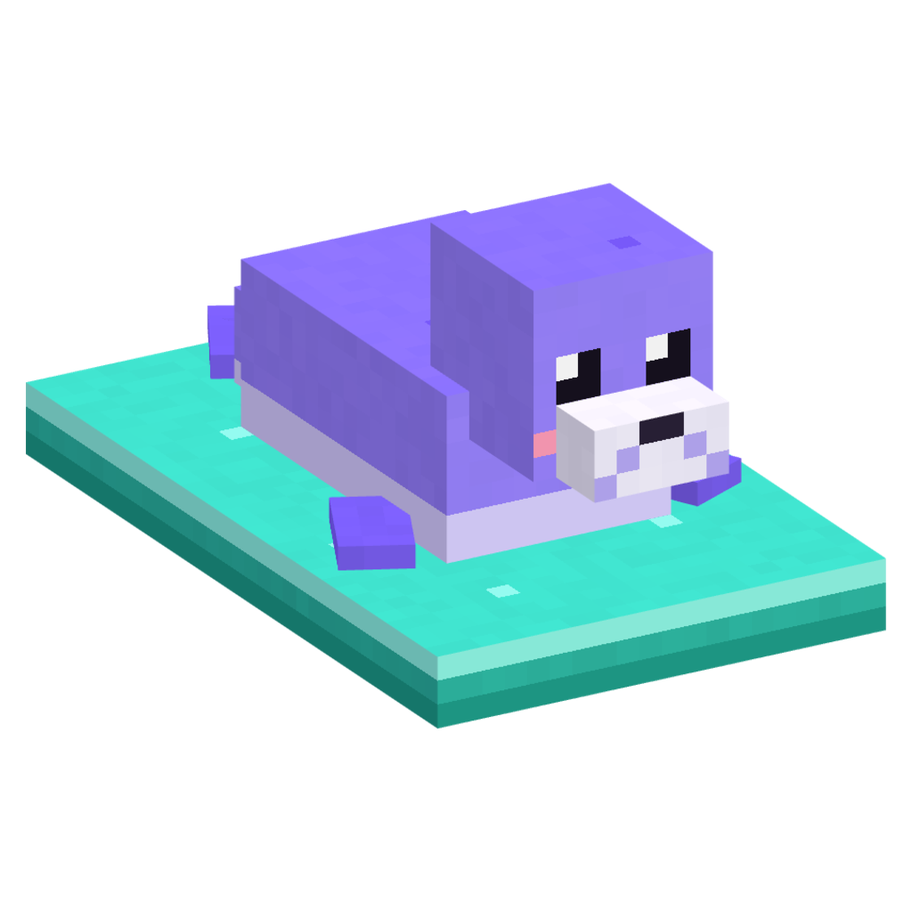
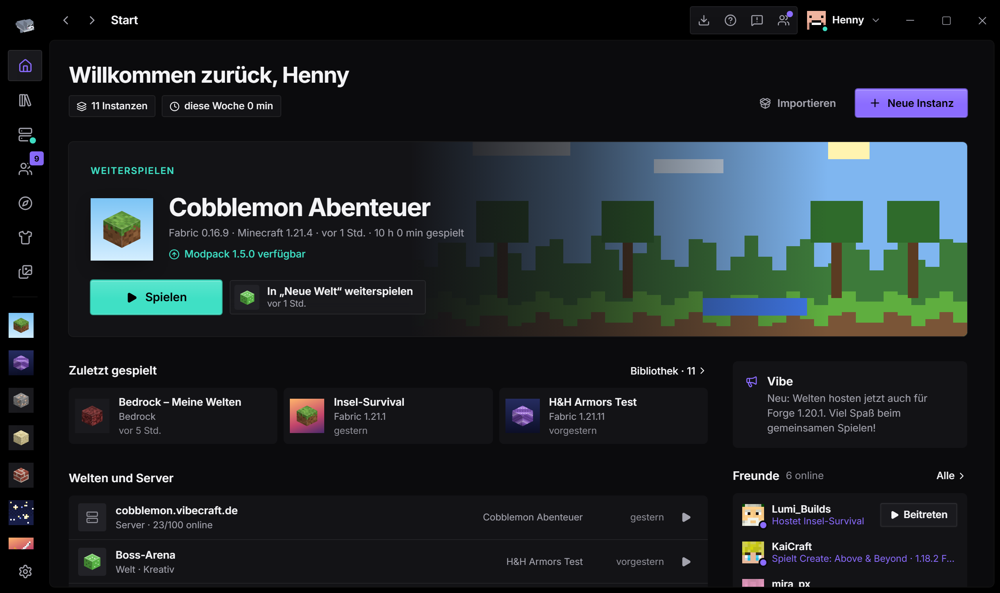
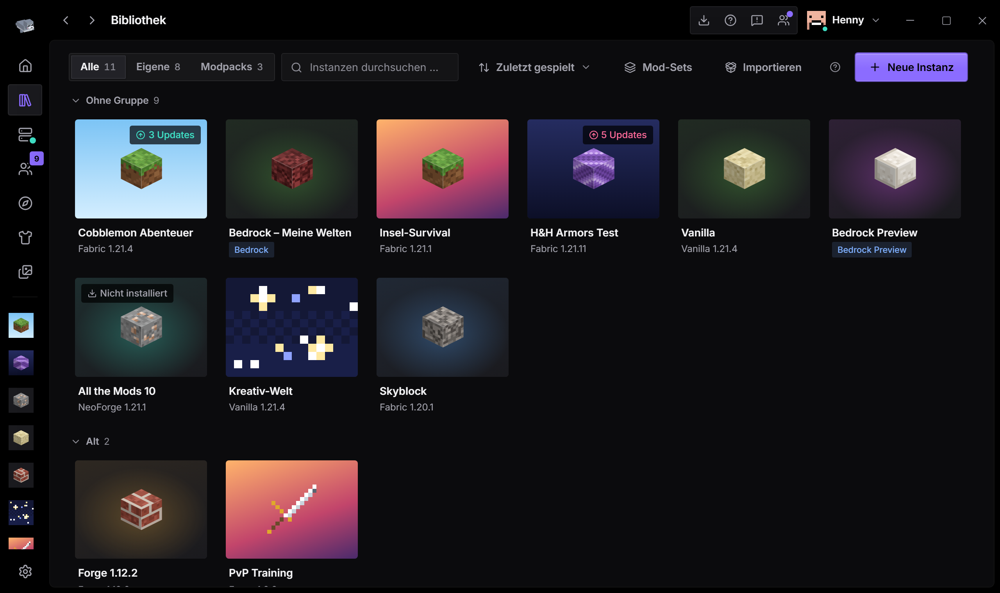
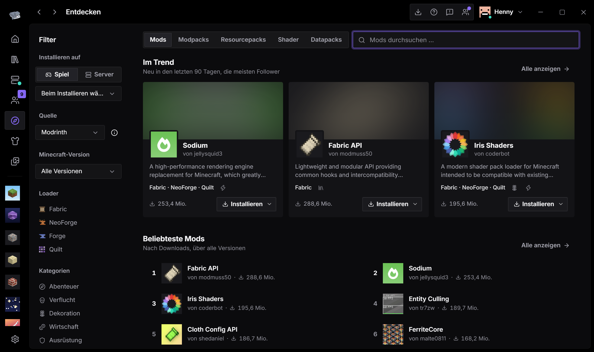
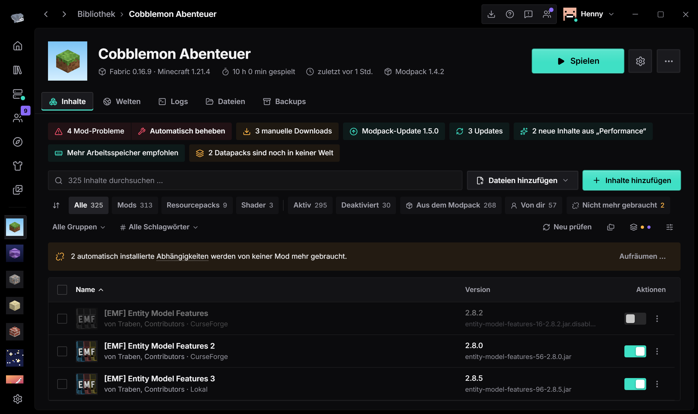
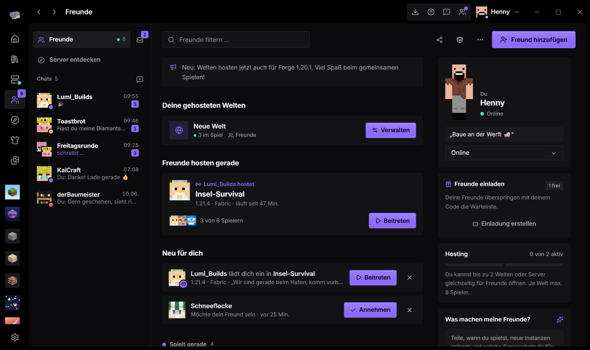
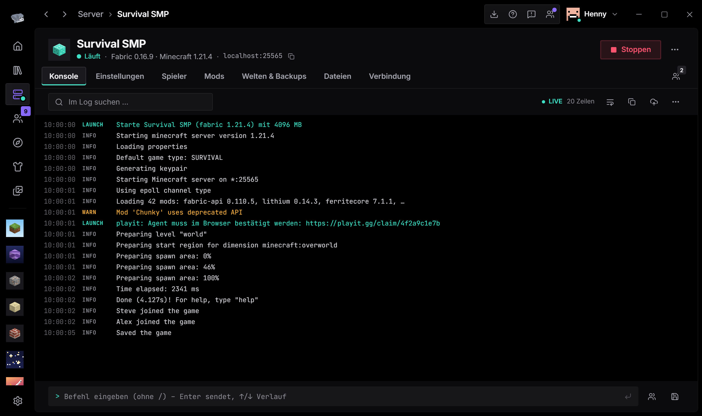
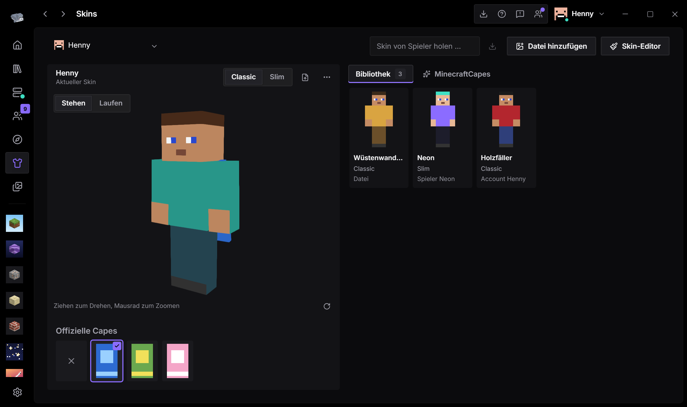
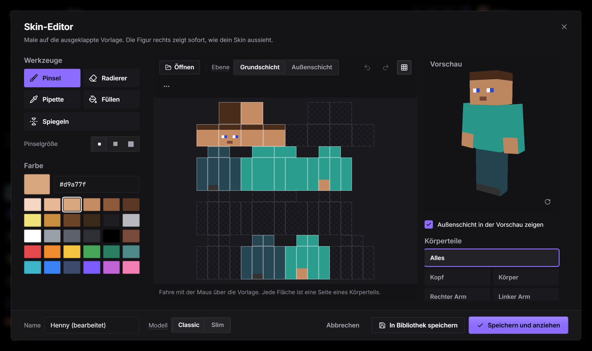
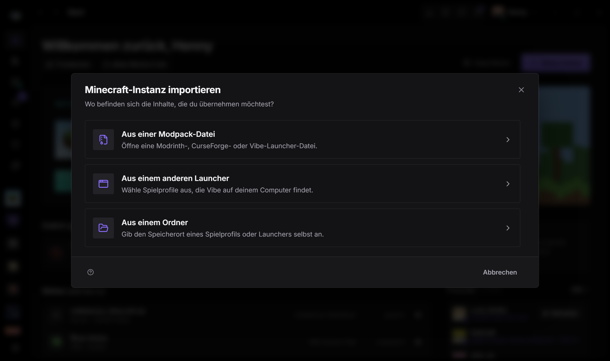

# Vibe Launcher

### Minecraft. Mods. Freunde. Ein Klick.

Der Launcher, der dir die Arbeit abnimmt: Modpacks installieren, Fehler beheben, 
mit Freunden spielen und eigene Server hosten – ohne Ordner-Chaos und ohne Frust.

## [⬇&nbsp; Kostenlos herunterladen](https://github.com/vibec-studios/vibe-launcher/releases/latest/download/Vibe-Launcher-Setup.exe)

Für Windows 10 & 11 · keine Admin-Rechte nötig · aktualisiert sich von selbst

 

 

<table>
<tr>
<td align="center" width="33%">

### ⚡ Schnell
Eine neue Vanilla-Instanz ist in **~9 Sekunden** installiert.
Spiele starten bis zu **40 %** schneller.

</td>
<td align="center" width="33%">

### 🪶 Leicht
Beim Spielen verschwindet der Launcher in den Infobereich –
**~12 MB** statt Hunderte.

</td>
<td align="center" width="33%">

### 💾 Sparsam
Gleiche Mods liegen nur **einmal** auf der Platte,
egal in wie vielen Instanzen.

</td>
</tr>
</table>

---

## 📚 Alle deine Welten an einem Ort

Vanilla, Fabric, Forge, NeoForge oder Quilt – leg so viele Instanzen an, wie du willst.
Java lädt der Launcher selbst, RAM stellst du mit einem Schieberegler ein. Fertig.

## 🧭 Mods & Modpacks finden – und mit einem Klick installieren

Tausende Mods, Modpacks, Shader und Resourcepacks von **Modrinth** und **CurseForge**.
Abhängigkeiten? Erledigt der Launcher. Passende Version? Sucht er dir raus.
Und das Ganze funktioniert genauso für deine **Server**.

## 🔧 Modpack kaputt? „Automatisch beheben“

Fehlende Abhängigkeiten, doppelte Mods, falsche Java-Version, zu wenig RAM:
Der Launcher erkennt Dutzende typische Probleme und repariert sie auf Knopfdruck.
Vorher legt er eine Sicherung an – ein Klick und alles ist wie vorher.

## 👋 Zusammen spielen

Freunde hinzufügen, chatten, sehen wer gerade was spielt – und mit **einem Klick beitreten**.
Deine Welt öffnest du für Freunde, ohne Portfreigabe und ohne Server mieten zu müssen.

## 🖥️ Eigene Server – zu Hause oder auf dem Root-Server

Mach aus jeder Instanz einen Server, installiere Plugins und Mods über „Entdecken“
und behalte alles in der Live-Konsole im Blick. Mit **Remote-Servern** steuerst du sogar
einen Server auf einem anderen PC – aus dem Launcher oder im Browser.

## 👕 Skins, Capes und ein eigener Editor

3D-Vorschau, Skin-Bibliothek, Skins von anderen Spielern übernehmen,
Capes umschalten – oder direkt im **Skin-Editor** Pixel für Pixel selbst malen.

<table>
<tr>
<td width="50%"></td>
<td width="50%"></td>
</tr>
</table>

## 🧳 Umziehen in einer Minute

Du hast schon Instanzen in der **Modrinth App**, **Prism**, **CurseForge** oder **ATLauncher**?
Der Launcher holt sie dir rüber – inklusive Welten und Einstellungen.
`.mrpack`, CurseForge-ZIPs und MultiMC-Exporte gehen natürlich auch.

## …und noch viel mehr

| | |
|---|---|
| 🌙 **AFK im Hintergrund** | Starte eine Instanz ohne Fenster und lass deine Farm laufen, während du etwas anderes machst. |
| 🗺️ **Weltkarten** | Schau dir deine Welten als Karte an – auch mit Xaero's und JourneyMap. |
| 🔄 **Mod-Updates** | Updates mit einem Klick oder automatisch vor jedem Start. Einzelne Mods lassen sich festhalten. |
| 🧹 **Speicherplatz** | Sieh auf einen Blick, was wie viel Platz belegt, und räum mit einem Klick auf. |
| 🖼️ **Screenshots** | Alle Screenshots aus allen Instanzen an einem Ort. |
| 📜 **Logs & Crashes** | Live-Konsole mit Suche, verständliche Crash-Erklärungen, Log teilen mit einem Klick. |
| 🎨 **Dein Look** | Hell, dunkel oder im Pixel-Style – oder lass dir von einer KI ein eigenes Theme bauen ([so geht's](skills/README.md)). |
| 🌍 **7 Sprachen** | Deutsch, Englisch, Französisch, Spanisch, Polnisch, Portugiesisch und Türkisch. |
| 🔐 **Sicher** | Login nur mit echtem Microsoft-Konto, Zugangsdaten im Windows-Tresor, Schutz vor Log4Shell. |

## In 3 Schritten spielen

1. **[Vibe-Launcher-Setup.exe herunterladen](https://github.com/vibec-studios/vibe-launcher/releases/latest/download/Vibe-Launcher-Setup.exe)** und starten.
2. Falls Windows warnt („Der Computer wurde durch Windows geschützt“): **Weitere Informationen → Trotzdem ausführen**.
   Das liegt nur daran, dass wir (noch) kein teures Signatur-Zertifikat haben.
3. Mit dem Microsoft-Konto anmelden, mit dem du Minecraft: Java Edition gekauft hast – los geht's.

## Häufige Fragen

<b>Kostet der Launcher etwas?</b>

Nein. Der Launcher ist kostenlos und quelloffen. Du brauchst nur ein gekauftes Minecraft: Java Edition.

<b>Gibt es den Launcher für Mac oder Linux?</b>

Im Moment nur für Windows 10 und 11.

<b>Was ist mit dem Vibey Client?</b>

Der Vibey Client wird nicht mehr weiterentwickelt – wir konzentrieren uns voll auf den Launcher.
Bestehende Instanzen funktionieren weiter; der Launcher zeigt dir einen Hinweis, mit dem du den Client
behalten oder entfernen kannst. Mehr dazu: [docs/VIBEY-CLIENT-EINGESTELLT.md](docs/VIBEY-CLIENT-EINGESTELLT.md).

<b>Wo liegen meine Daten?</b>

Unter `%APPDATA%\VibeLauncher`. Deine Zugangsdaten liegen verschlüsselt im Windows-Tresor, nie im Klartext.

<b>Ich habe einen Fehler gefunden oder eine Idee.</b>

Im Launcher oben rechts auf das Feedback-Symbol klicken – oder ein
[Issue auf GitHub](https://github.com/vibec-studios/vibe-launcher/issues) erstellen.

## Mitmachen

Du willst am Launcher mitbauen oder ihn übersetzen? Alles Technische steht in
**[docs/DEVELOPMENT.md](docs/DEVELOPMENT.md)**, fürs Übersetzen gibt es [docs/TRANSLATING.md](docs/TRANSLATING.md).

---

## English

**Vibe Launcher** is a free Minecraft launcher for Windows. Install modpacks from Modrinth and CurseForge in one click,
let it fix broken packs automatically, play with friends, host your own servers (even remote ones), edit skins,
and move over from the Modrinth App, Prism, CurseForge or ATLauncher in a minute.
**[Download for Windows](https://github.com/vibec-studios/vibe-launcher/releases/latest/download/Vibe-Launcher-Setup.exe)** ·
Developers: [docs/DEVELOPMENT.md](docs/DEVELOPMENT.md)

## Lizenz / License

**Code:** [Apache License 2.0](LICENSE). Forken, ändern und weitergeben ist erlaubt.

**Nicht** von der Code-Lizenz erfasst (gilt für alle Repos von Vibe Craft Studios,
[LICENSING.md](https://github.com/vibec-studios/.github/blob/main/LICENSING.md)):

- **Namen und Logos** („Vibe“, „Vibey“, „Vibe Craft Studios“, die Robbe): Forks brauchen einen eigenen Namen und
  eigene Logos – [TRADEMARKS.md](https://github.com/vibec-studios/.github/blob/main/TRADEMARKS.md).
- **Grafiken und Modelle** (Branding, Icons, Robbe): alle Rechte vorbehalten –
  [ASSETS-POLICY.md](https://github.com/vibec-studios/.github/blob/main/ASSETS-POLICY.md); Pfade in [NOTICE](NOTICE).
- **Vibe-Dienste** (Backend `vibe.axolite.app`, Relay `relay.axolite.cc`, siehe [docs/DOMAINS.md](docs/DOMAINS.md)):
  nur für offizielle Builds – [SERVICES.md](https://github.com/vibec-studios/.github/blob/main/SERVICES.md).

*English:* the code is Apache-2.0. Our names and logos, the seal, artwork and models, and the Vibe online services are
not included: forks must use their own name, artwork and backend. See the linked policies.

 
Gemacht mit 💜 von <b>Vibe Craft Studios</b> · Nicht offiziell von Mojang oder Microsoft.

