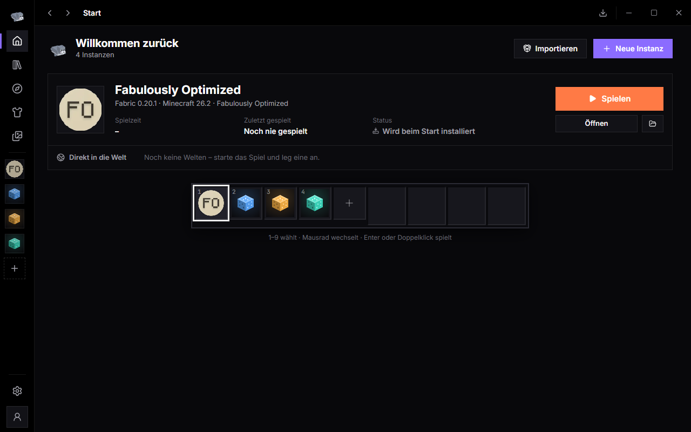
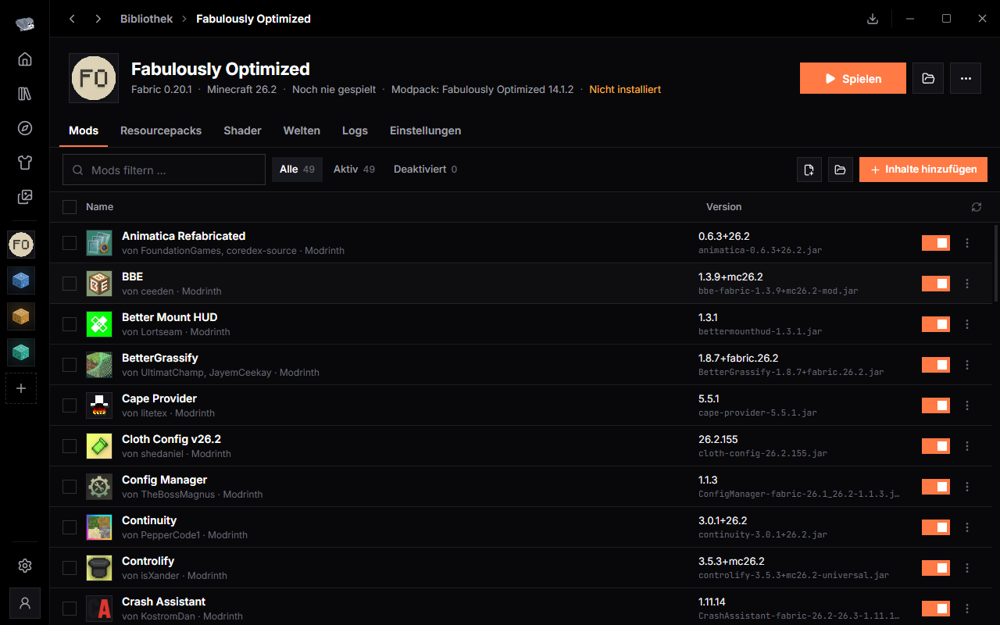
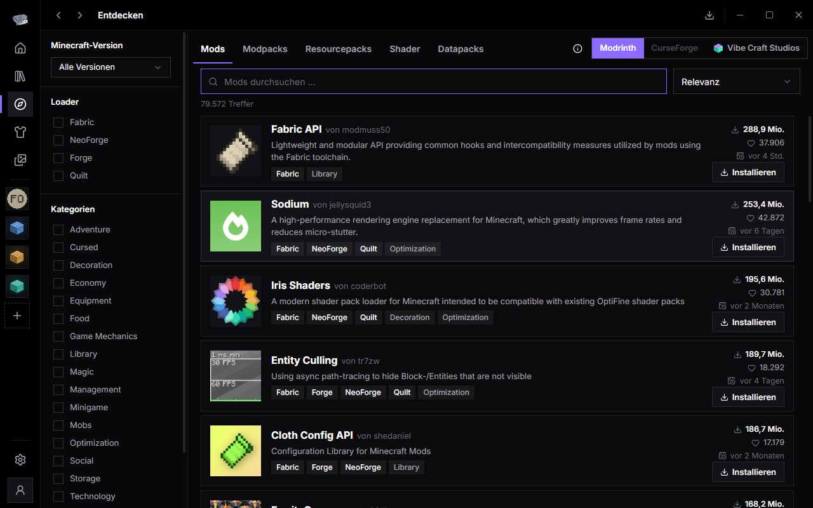
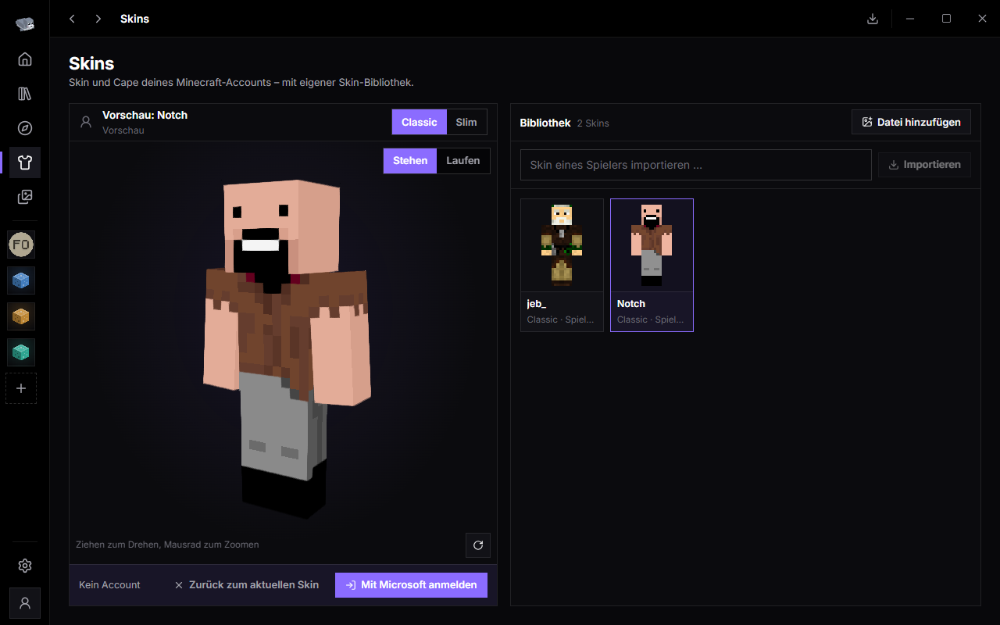
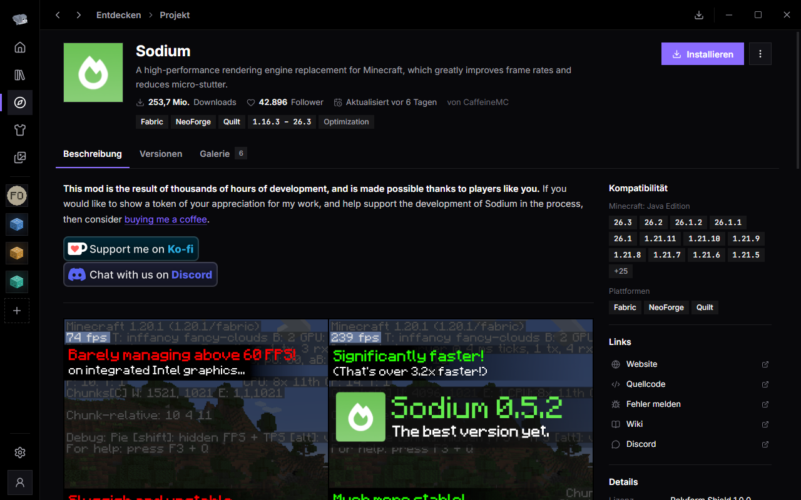

<div align="center">


# Vibe Launcher

**Der Minecraft-Launcher von Vibe Craft Studios.**<br>
Instanzen, Mods, Modpacks, Skins – schnell, aufgeräumt und ohne Schnickschnack.

[](https://github.com/vibec-studios/vibe-launcher/releases/latest)
[](https://github.com/vibec-studios/vibe-launcher/releases)
[](https://github.com/vibec-studios/vibe-launcher/actions/workflows/ci.yml)


### [⬇ Download für Windows](https://github.com/vibec-studios/vibe-launcher/releases/latest/download/Vibe-Launcher-Setup.exe)

<sub>Kostenlos · Installation ohne Admin-Rechte · aktualisiert sich selbst</sub>

</div>

<br>



<table>
<tr>
<td width="50%"></td>
<td width="50%"></td>
</tr>
<tr>
<td width="50%"></td>
<td width="50%"></td>
</tr>
</table>

## Was er kann

| | |
|---|---|
| 🎮 **Instanzen** | Vanilla, Fabric, Quilt, Forge und NeoForge – je Instanz eigener Ordner, RAM, Java und JVM-Argumente. Java lädt der Launcher selbst. |
| 🧭 **Entdecken** | Mods, Modpacks, Resource- und Shaderpacks von **Modrinth**, **CurseForge** und eigenen **Stores** (Vibe Craft Studios ist schon drin) – inklusive Abhängigkeiten. |
| 🔄 **Mod-Updates** | Updates prüfen und mit einem Klick einspielen – oder automatisch vor jedem Start. Einzelne Mods lassen sich fixieren. |
| 📦 **Import & Export** | `.mrpack`, CurseForge-ZIP, eigenes `.vlpack`, Prism/MultiMC – und **direkt aus anderen Launchern** (Modrinth App, Prism, CurseForge App, ATLauncher). |
| 🟫 **Hotbar & Direkt in die Welt** | Die Startseite ist eine Minecraft-Hotbar (Tasten 1–9). Ein Klick auf eine Welt startet das Spiel direkt darin. |
| 👕 **Skins & Capes** | 3D-Vorschau, eigene Skin-Bibliothek, Skins per Datei oder Spielername, Capes umschalten. Dazu **MinecraftCapes**: eigenes (auch animiertes) Cape und Ohren in der Vorschau, die Mod per Schalter je Instanz (abschaltbar; abgefragt wird nur die eigene UUID). |
| 🖼️ **Screenshots** | Alle Screenshots aller Instanzen an einem Ort – mit Großansicht, Kopieren und Löschen. |
| 📜 **Logs** | Live-Konsole mit Filtern und Suche, Crash-Erkennung, Upload zu **mclo.gs** mit einem Klick. |
| 🔐 **Accounts** | Microsoft-Login, mehrere Konten; Tokens liegen im Windows-Tresor, nie im Klartext. |
| ⬆️ **Updates** | Der Launcher aktualisiert sich selbst – Kanal **Release** (stabil) oder **Dev** (jeder neue Commit). |

## Installation

1. **[Vibe-Launcher-Setup.exe](https://github.com/vibec-studios/vibe-launcher/releases/latest/download/Vibe-Launcher-Setup.exe)** herunterladen und starten.
2. Windows warnt eventuell („Der Computer wurde durch Windows geschützt“), weil der Installer (noch) kein gekauftes
   Code-Signing-Zertifikat hat → **Weitere Informationen → Trotzdem ausführen**.
3. Unten links mit dem Microsoft-Konto anmelden, mit dem Minecraft: Java Edition gekauft wurde – fertig.

Voraussetzung: Windows 10/11 (64 Bit). Daten liegen unter `%APPDATA%\VibeLauncher`.

---

## Entwicklung

Benötigt: [Node.js](https://nodejs.org) 22+, [pnpm](https://pnpm.io) 11, [Rust](https://rustup.rs) (stable, MSVC),
Visual Studio Build Tools („Desktopentwicklung mit C++“).

```bash
pnpm install
node scripts/dev-live.mjs        # App mit Live-Reload (lädt dist/ direkt von der Platte)
pnpm typecheck && pnpm build     # Frontend prüfen/bauen
cd src-tauri && cargo test       # Backend-Tests
```

**Testmodus mit eigenem Datenordner:** Ist `VIBE_LAUNCHER_HOME` gesetzt, nutzt der Launcher diesen Ordner statt
`%APPDATA%\VibeLauncher`, die Single-Instance-Sperre ist aus und Tokens landen unter einem eigenen
Schlüsselbund-Namen (`VibeLauncher-test-…`). So laufen mehrere Testinstanzen parallel, ohne echte Daten zu berühren:

```powershell
$env:VIBE_LAUNCHER_HOME = "$env:TEMP\vibe-test"; pnpm tauri dev
```

**Spielstart ohne Microsoft-Konto (nur Debug-Builds, für automatisierte Tests):** `VIBE_DEV_OFFLINE_ACCOUNT=<Name>`
setzen – ist kein Account aktiv, startet das Spiel dann mit einem Offline-Profil dieses Namens. Das taucht weder in
der Oberfläche noch in `accounts.json` auf und ist im Release-Build nicht enthalten.

Frontend ohne Backend (Mock): `VITE_MOCK=1 pnpm vite`. Architektur, Commands und Events: [docs/CONTRACT.md](docs/CONTRACT.md).

## Konfiguration

Zwei Schlüssel werden **beim Kompilieren** aus Umgebungsvariablen eingebettet (siehe [.env.example](.env.example)).
Nutzer können beide auch in den Einstellungen des Launchers überschreiben.

| Variable | Wofür | Ohne Wert |
|---|---|---|
| `CURSEFORGE_API_KEY` | CurseForge-Suche/Downloads | CurseForge ist ausgeblendet, Modrinth funktioniert |
| `VIBE_MSA_CLIENT_ID` | Microsoft-Login | keine Anmeldung möglich (Spielstart gesperrt) |

### CurseForge-API-Key

1. Auf [console.curseforge.com](https://console.curseforge.com) mit einem CurseForge-/Overwolf-Konto anmelden.
2. Unter **API keys** einen Key anlegen (für veröffentlichte Apps ggf. das Formular „Apply for API key“ ausfüllen).
3. Key als `CURSEFORGE_API_KEY` setzen.

### Microsoft-Login: Azure-App registrieren

Der Launcher nutzt den **Device-Code-Flow** (Code auf microsoft.com/link eingeben). Dafür braucht es eine eigene
Azure-App-Registrierung:

1. [portal.azure.com](https://portal.azure.com) → **Microsoft Entra ID** → **App registrations** → **New registration**.
2. Name z. B. „Vibe Launcher“. Bei **Supported account types**:
   **„Personal Microsoft accounts only“** wählen (Minecraft-Konten sind private Microsoft-Konten).
3. **Redirect URI**: leer lassen – für den Device-Code-Flow nicht nötig. → **Register**.
4. In der App: **Authentication** → *Advanced settings* → **Allow public client flows** = **Yes** → *Save*.
5. Kein Client-Secret anlegen (Desktop-Apps sind öffentliche Clients). API-Berechtigungen müssen nicht ergänzt werden –
   der Scope `XboxLive.signin offline_access` wird beim Login angefragt.
6. Die **Application (client) ID** (GUID auf der Übersichtsseite) als `VIBE_MSA_CLIENT_ID` setzen.
7. **Freigabe durch Mojang beantragen:** Neue Client-IDs dürfen die Minecraft-API erst nach Prüfung nutzen.
   Formular: <https://aka.ms/mce-reviewappid> (Client-ID, Tenant-ID und Projektbeschreibung angeben).
   Bis zur Freigabe endet der Login nach erfolgreicher Microsoft-/Xbox-Anmeldung mit der Meldung
   „Die Azure-App ist (noch) nicht für die Minecraft-API freigeschaltet“. Die Freigabe kann einige Tage dauern.

## Release-Prozess & Update-Kanäle

- **Release-Kanal:** Tag `vX.Y.Z` pushen → GitHub Actions baut und veröffentlicht das Release.
- **Dev-Kanal:** jeder Commit auf `main` → neuer Dev-Build im Vorab-Release `dev`.
- Im Launcher unter *Einstellungen → Updates* umschaltbar; Updates erscheinen oben rechts als „Update verfügbar“.

Details: [docs/RELEASE.md](docs/RELEASE.md). Der private Updater-Schlüssel gehört **nie** ins Repository.

## English

**Vibe Launcher** is a Minecraft launcher for Windows by Vibe Craft Studios: instances with Fabric/Quilt/Forge/NeoForge,
Modrinth & CurseForge browsing, modpack import/export, Microsoft accounts (device code), log upload to
mclo.gs and signed auto-updates. Download the `…_x64-setup.exe` from the
[latest release](https://github.com/vibec-studios/vibe-launcher/releases/latest).

**Development:** `pnpm install`, `node scripts/dev-live.mjs` (live reload), `cd src-tauri && cargo test`. Set `VIBE_LAUNCHER_HOME` to use a
separate data folder (test mode, no single-instance lock, separate keyring namespace).

**Configuration (build time):** `CURSEFORGE_API_KEY` (from console.curseforge.com) and `VIBE_MSA_CLIENT_ID`
(Azure app registration: *Personal Microsoft accounts only*, *Allow public client flows* = Yes, no redirect URI needed;
new client IDs must be approved by Mojang via <https://aka.ms/mce-reviewappid> before they can access the Minecraft API).

**Releases:** set the secrets `TAURI_SIGNING_PRIVATE_KEY` (+ optional `_PASSWORD`), `CURSEFORGE_API_KEY`,
`VIBE_MSA_CLIENT_ID`, bump the version in `package.json` and `src-tauri/Cargo.toml`, push a `vX.Y.Z` tag, then publish the
draft release created by GitHub Actions. See [docs/RELEASE.md](docs/RELEASE.md).

## Lizenz / License

**Code:** [Apache License 2.0](LICENSE). Forken, ändern und weitergeben ist erlaubt.

**Nicht** von der Code-Lizenz erfasst (gilt für alle Repos von Vibe Craft Studios,
[LICENSING.md](https://github.com/vibec-studios/.github/blob/main/LICENSING.md)):

- **Namen und Logos** („Vibe“, „Vibey“, „Vibe Craft Studios“, die Robbe): Forks brauchen einen eigenen Namen und
  eigene Logos – [TRADEMARKS.md](https://github.com/vibec-studios/.github/blob/main/TRADEMARKS.md).
- **Grafiken und Modelle** (Branding, Icons, Robbe, Cosmetics): alle Rechte vorbehalten –
  [ASSETS-POLICY.md](https://github.com/vibec-studios/.github/blob/main/ASSETS-POLICY.md); Pfade in [NOTICE](NOTICE).
- **Vibe-Dienste** (Backend `vibe.axolite.app`, Relay `relay.axolite.cc`; früher `vibe.henny.dev`/`vibey.henny.dev`, siehe [docs/DOMAINS.md](docs/DOMAINS.md)): nur für offizielle Builds –
  [SERVICES.md](https://github.com/vibec-studios/.github/blob/main/SERVICES.md).

*English:* the code is Apache-2.0. Our names and logos, the seal, artwork and models, and the Vibe online services are
not included: forks must use their own name, artwork and backend. See the linked policies.
